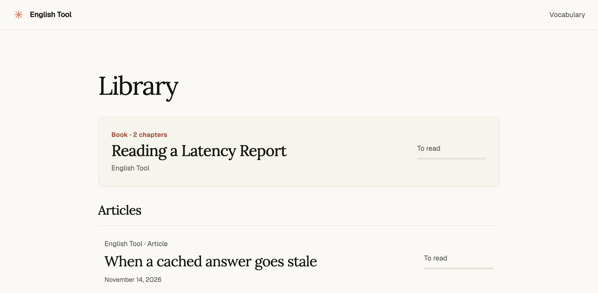
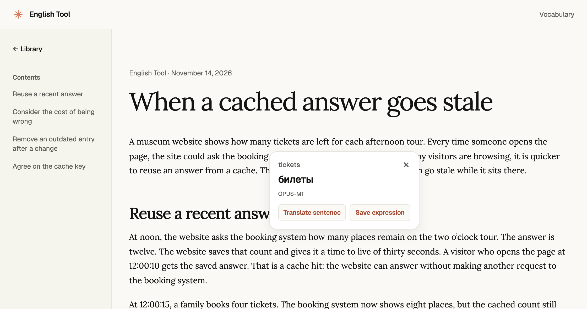

# English Tool

English Tool is a self-hosted web reader for learning vocabulary from English articles and books at any level. Click a word or select a phrase to look it up in place. Save useful expressions with their original sentences, review them later, and return to the passage they came from. The library keeps your reading position and completion status, and optional quizzes let you check your understanding of a text. Progress, saved expressions and review sessions sync between the browsers and devices that open the same server, and the reader has a warm light theme and a dark theme. After each text, **Your take** asks whether you want more like it and how hard the English was, and agents such as Claude Code or Codex can use those answers to suggest what to read next.



## Quick start

Install Node.js 24 or later, then run:

```sh
git clone https://github.com/ekv24/english-tool.git
cd english-tool
npm ci
npm start
```

Open [English Tool](http://127.0.0.1:4173/), choose **When a cached answer goes stale**, and click **stale** in the text to see its English gloss. Click **Save expression**, then open **Vocabulary**. Open the saved entry, select **Add to review** if needed, and start a review. **Reading a Latency Report** demonstrates book navigation and chapter quizzes. The examples work without a translation model.

To read your own texts, see [Adding articles and books](docs/materials.md). If you use Codex, the repository includes the [material preparation skill](.agents/skills/prepare-english-tool-material/SKILL.md).

## Look up a word while reading

Click a word or select a phrase to open a lookup next to the text. The screenshot shows OPUS-MT translating **tickets** into Russian.



## Review saved expressions

Open **Vocabulary** and choose **Start review** to practise up to five saved expressions at a time. The reader suggests technical terms from glossaries and expressions that recur across your library first. Use **Add to review** or **Exclude from review** on a saved expression to override the suggestion. Recall the meaning, choose **Show answer**, then **Remembered** or **Again**. Remembered expressions come back after a growing interval, and forgotten ones come back the next day. **Show context** shows the sentence you saved the expression from, and **Source passage** opens it in the text.

Machine translations of single words are often wrong in context. If you use the Codex CLI, `npm run check-vocabulary` has it check newly saved expressions against their sentences and correct them, keeping their review history ([details, in Russian](docs/agents/vocabulary-check.md)).

## Tell it what you think, get suggestions

At the end of every article and chapter, and on a book's page, **Your take** records your interest (**More like this**, **It was fine**, **Not for me**) and how hard the English was (**Easy**, **Just right**, **Hard**), with an optional note. While you read, the reader also counts active reading time and lookups for each text, a rough measure of its difficulty.

`npm run interests` gives agents the same view through the running reader's API:

```sh
npm run interests -- digest                      # what you read, how it went, notes and suggestions
npm run interests -- note "Loved the examples" --material cache-freshness --kind feedback
npm run interests -- suggest --title "…" --url https://… --kind article --why "…" --score 0.7
```

Suggestions appear under **For you** in the library, where **Want to read** keeps one and **Not interested** hides it. All of this stays in the reader's database. [docs/agents/recommendations.md](docs/agents/recommendations.md) describes how agents log feedback from a chat and look for new materials (in Russian), and `.agents/skills/` holds the matching skills.

## Read on several devices

The server keeps reading positions, completion marks, saved expressions and the review session in one SQLite database. Each browser keeps a copy and sends its changes when it opens a page or regains a connection, so you can stop reading on a laptop and continue on a phone, or finish a review that you started on another device. Answers given offline wait in the browser until the connection returns.

The button in the top bar switches between the light and dark themes. Without a saved choice, the reader follows the system setting.

## Choose a lookup language

The reading text and interface are in English. Set `ENGLISH_TOOL_TARGET_LANGUAGE` to a BCP 47 language tag such as `en`, `es`, or `pt-BR` to choose one lookup language for the server. The default is `en`. A glossary supplies short definitions or translations for its material in the selected language. When a selection has no glossary entry, a configured model can look it up.

**Ollama** supports lookups with a model that can translate from English into your target language. For English definitions, use a model that can follow an instruction to define or explain English text. With [Ollama](https://docs.ollama.com/) running and the model installed, set its name on startup. Replace the placeholder with the name of a model available in your Ollama installation.

```sh
ENGLISH_TOOL_TARGET_LANGUAGE=es \
  ENGLISH_TOOL_OLLAMA_MODEL=your-installed-model \
  npm start
```

The reader uses `http://127.0.0.1:11434` by default. Set `ENGLISH_TOOL_OLLAMA_URL` for a different Ollama endpoint. That endpoint receives the selected text or surrounding sentence for model lookups.

**OPUS-MT** uses a compatible Hugging Face translation model through Transformers.js. Pick a checkpoint for the English-to-target language pair, then set the same variables when preparing the model and starting the server.

```sh
export ENGLISH_TOOL_TARGET_LANGUAGE=ru
export ENGLISH_TOOL_OPUS_MODEL=Xenova/opus-mt-en-ru
npm run prepare:model
npm start
```

Set `ENGLISH_TOOL_OPUS_REVISION` to pin a specific checkpoint revision. The default is `main`. Model preparation downloads the files for local inference. For English definitions, use the glossary or Ollama. When both providers are configured, the reader uses OPUS-MT for selections and prefers Ollama for surrounding sentences. If Ollama does not answer within 8 seconds, OPUS-MT translates the sentence instead.

**TranslateGemma** gives better sentence translations than OPUS-MT for many languages. Install a TranslateGemma model in Ollama and set its name, for example `ENGLISH_TOOL_OLLAMA_MODEL=translategemma:4b`. The reader then uses the prompt format the model was trained with and passes the glossary terms that occur in the sentence, so the translation keeps the glossary's terminology. The earlier setting name `ENGLISH_TOOL_SENTENCE_MODEL` is still accepted.

The reader remembers recent lookups and loads OPUS-MT when the server starts, so the first lookup does not wait for the model. Set `ENGLISH_TOOL_WARM_MODELS=0` to load it on first use instead. While a page is open, the reader also asks Ollama to keep its model loaded.

## Self-hosting and data

The server listens on `127.0.0.1:4173`. Set `PORT` to use a different local port. Each running instance is for one reader. It shares one SQLite database across browsers and has no built-in login. For access from other devices, use a private tunnel or an authenticated HTTPS reverse proxy that restricts access to that reader. Keep the reader's port off the public internet.

`scripts/private-reader-proxy.mjs` is a small HTTP Basic authentication proxy for that setup. It listens on `127.0.0.1:4174`, reads its password from `.local/reader-password`, and forwards requests to the reader on port 4173. Put a TLS-terminating tunnel or proxy in front of it.

By default, personal data lives in `.local/`. You can place it outside the checkout by setting `ENGLISH_TOOL_DATA_DIR` to an absolute directory path. The database is `reader-state/reader.sqlite` within that data directory. Set `ENGLISH_TOOL_STATE_DB` for a separate database path or `ENGLISH_TOOL_EXAMPLES=0` to hide the bundled examples. Back up the data directory and any separately configured database to keep imported files, vocabulary, and progress.

Russian notes on the author's own setup, with the preparation steps for the materials in `materials/`, are in [docs/self-hosting.ru.md](docs/self-hosting.ru.md).

## Repository layout

- `server.mjs`, `library.mjs`, `book.mjs` and `translation.mjs` serve the reader. `assets.mjs` versions the files in `public/`, so browsers can cache them.
- `reader-state.mjs`, `vocabulary-review.mjs` and `vocabulary-terms.mjs` keep the synced state and choose the expressions to review. `public/reader-records.js` defines every kind of record in that state.
- `scripts/interests.mjs` is the command line for agents: digest, journal notes, suggestions and the interest profile.
- `examples/` holds the bundled demo materials.
- `materials/` holds glossaries, quizzes and metadata for the author's own library. See [companion files](docs/materials.md#companion-files-in-the-repository).
- `scripts/` holds the importers used to prepare those materials. They write to `.local/`.
- `docs/specs/`, `docs/adr/`, `docs/research/`, `GLOSSARY.md` and `.scratch/` hold the requirements, decisions, research notes, terms and work items, in Russian.

## Checks

```sh
npm run check
npm test
```

`npm test` also contains tests for the author's own library. They need prepared books, articles and the OPUS-MT model in `.local/`, and are skipped with the missing path as the reason when that data is absent.

To run the browser tests, install Chromium and WebKit through Playwright first.

```sh
npx playwright-core install chromium webkit
npm run test:browser
```
